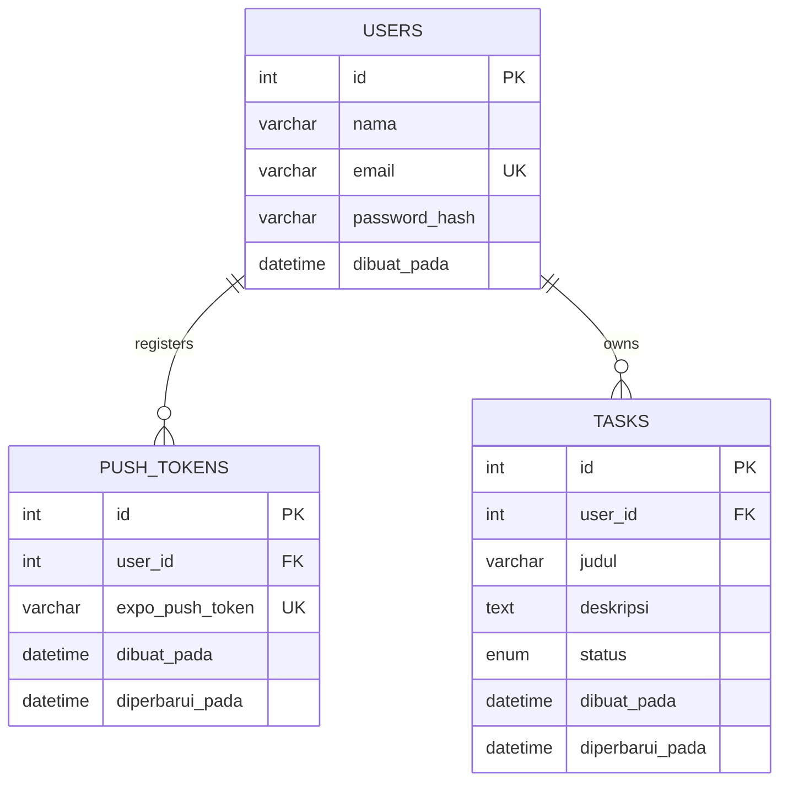

# ERD TaskFlow

Setiap query tugas difilter menggunakan `user_id` dari claim `sub` pada JWT yang telah diverifikasi. ID tugas tidak dianggap cukup sebagai otorisasi. Foreign key `ON DELETE CASCADE` menghapus token dan tugas milik akun yang dihapus.
